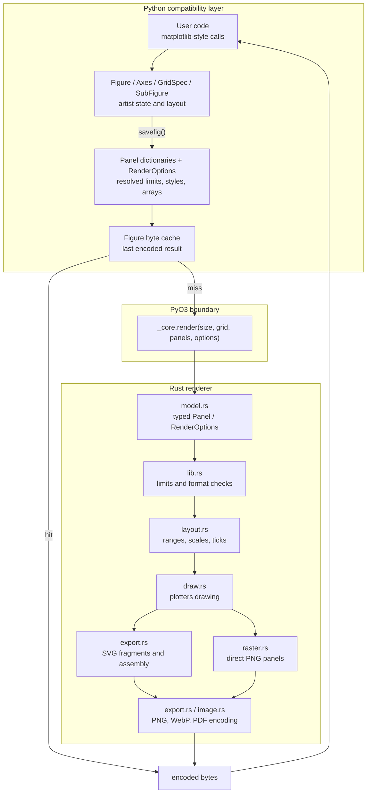
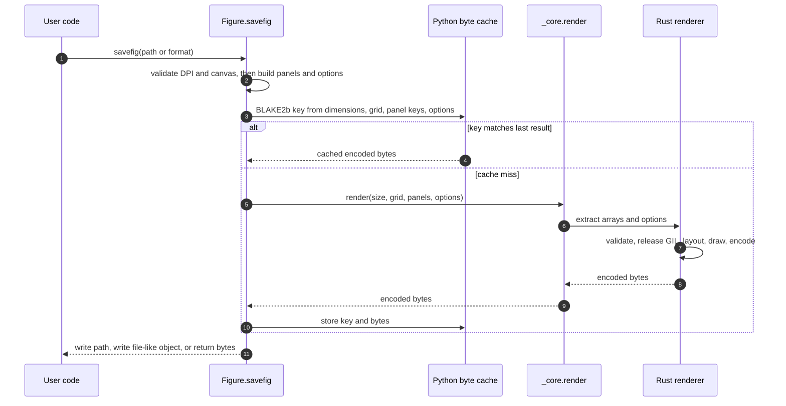
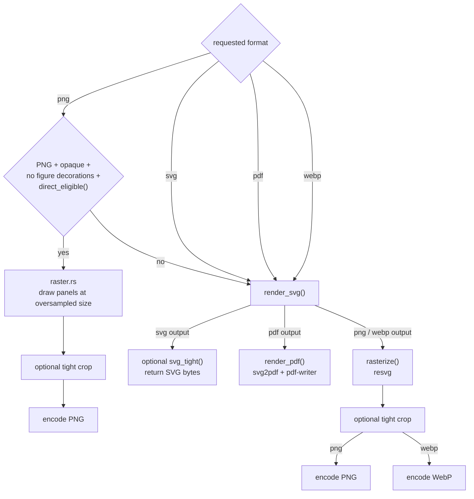

# Architecture

Matplotvite is a Python compatibility facade over a Rust renderer. Python code
builds the same kind of figure state that matplotlib would, but the state is
frozen into plain panel dictionaries at save time and handed to Rust through a
small PyO3 boundary. Rust performs layout, drawing, rasterisation, and encoding;
the Python layer never participates in the pixel pipeline.

The design keeps the public API easy to extend without rebuilding the renderer,
and keeps the native side independent of CPython objects once extraction is
complete.

## System map

The important boundary is `src/lib.rs::render`: Python owns path inference and
input validation conventions; Rust owns rendering and returns encoded bytes.
Once the NumPy arrays have been copied into `model::Panel`, the GIL is released
and the native work is independent of Python.

## Repository map

| Path | Responsibility |
|---|---|
| `python/matplotvite/__init__.py` | Public matplotlib-style API, artist state, GridSpec/SubFigure layout, panel serialisation, output-path handling, and the last-result byte cache. |
| `python/matplotvite/__init__.pyi` | PEP 561 type surface shipped with the wheel. |
| `src/lib.rs` | PyO3 entry point, canvas/format validation, output routing, GIL release. |
| `src/model.rs` | `Panel`, `RenderOptions`, and the typed artist records extracted from Python. |
| `src/layout.rs` | Data ranges, autoscaling, axis bounds, and tick generation. |
| `src/draw.rs` | Plotters drawing of series, axes, text, legends, images, contours, and collections. |
| `src/fonts.rs` | Registration of the embedded Geist font faces used by the drawing stack. |
| `src/raster.rs` | Direct opaque-PNG path: panel rendering at an oversampled resolution and box filtering. |
| `src/export.rs` | SVG assembly, the per-panel fragment cache, PDF conversion, rasterisation, PNG/WebP encoding. |
| `src/image.rs` | Image scaling, background compositing, and image-to-PNG helpers. |
| `src/color.rs`, `src/cmap_data.rs` | Colour normalisation and colormap tables. |
| `src/scale.rs` | Integer-oversampling drawing backend used by the bitmap path. |
| `bench.rs`, `benches/render.rs` | Criterion-facing output-stage benchmarks. |

## Save and render flow

`Figure.savefig()` is the normal entry point. It validates the requested DPI
and canvas size, converts each visible `Axes` into a panel dictionary, resolves
text/axes coordinates into the form the renderer understands, computes a
fingerprint, and either reuses the previous bytes or calls `_core.render()`.

A saved figure is immutable with respect to the cache: changing any artist,
style, label, DPI, size, or output option changes the cache key. The cache holds
the last encoded result per `Figure`, not a history of results.

## Output routing

The renderer has two output paths. The direct bitmap path is a PNG optimisation;
all other formats and cases go through an SVG document.

The direct path is selected only when the output is an opaque PNG, there are no
figure-level decorations, and `direct_eligible()` accepts the panels. Dense
marker layers, images that require smoothing, and small single-panel figures
stay on the SVG path, where resvg applies the full vector rendering.

## Drawing and layout

`layout.rs` turns data and explicit limits into finite axis ranges, applies the
matplotlib-style padding rule, and computes tick positions and labels. It also
handles logarithmic scales and the figure/axes panel rectangles.

`draw.rs` draws one panel into an SVG fragment using plotters' SVG backend.
Each fragment uses absolute canvas coordinates, so `export.rs` can concatenate
independent panel fragments in panel order rather than translating each panel
into a shared coordinate system. Text uses embedded DejaVu Sans by default,
with Geist serif and monospace faces; no system font lookup or graphics stack
is required.

Dense scatter, collection, and marker layers can be composited into bitmap
overlays inside the SVG path. That keeps the vector document small while
preserving the vector output for the rest of the figure.

## Caching and concurrency

There are two caches:

| Cache | Scope | Key | Bound |
|---|---|---|---|
| `Figure._render_cache` | Python, per figure | BLAKE2b of dimensions, grid, panel fingerprints, and output options | One encoded result |
| `PANEL_CACHE` | Rust, process-wide | Panel fingerprint + canvas + grid + top padding + raster mode | 256 fragments or 64 MiB |

The Rust cache stores SVG panel fragments and is used by the vector path. It is
safe to share across figures because the key includes every input that can
change a fragment. The Python cache avoids even entering Rust when the same
figure is saved twice unchanged.

After extraction, `lib.rs` releases the GIL with `py.detach`. Rayon then renders
independent panels in parallel in both `render_svg()` and `render_png()`;
image row scaling and some raster operations are parallelised as well.

## Data and compatibility boundaries

The Python layer deliberately implements a focused subset of matplotlib rather
than a full transform stack:

- `Figure`, `Axes`, `GridSpec`, `SubplotSpec`, and `_SubFigure` hold the
  user-facing state and produce panel dictionaries.
- `Axes._panel()` resolves axis/figure-fraction text, limits, ticks, bars,
  collections, and images into the typed records in `src/model.rs`.
- `RenderOptions` carries format, DPI, transparency, tight-cropping,
  compression, figure title, and figure-level text.
- The Rust side never imports Python modules or calls back into user code; after
  extraction it works only with copied numeric arrays and strings.

To add a feature, the usual path is:

1. Add the matplotlib-compatible method or property in the Python facade.
2. Add or extend a record in `src/model.rs` and populate it from `_panel()`.
3. Draw it in `src/draw.rs` (and, if needed, route it through `src/export.rs`).
4. Add a Python regression test and, where relevant, a gallery example.

Canvas limits, bin limits, and grid-cell limits are enforced in Python for early
errors and again in Rust at the FFI boundary for defence in depth. The shipped
package does not shell out or use `eval`/`exec`; the gallery harvester is a
development tool and executes pinned third-party snippets in-process, as
documented in the README.

## Verification surfaces

- `pytest` covers the Python API, render options, and output formats.
- `cargo test` covers layout, raster, and encoding invariants.
- `tools/trace_unsupported.py --check` tracks calls from matplotlib's own test
  suite.
- The comparison galleries exercise pinned matplotlib and seaborn material;
  their rendered counts are an upper bound because pinned helper code can do
  part of the work.
- `prek` and CI run formatting, Clippy, Rust tests, Bandit, and the security
  audit. `prek checks` is a required status check for `main`.
