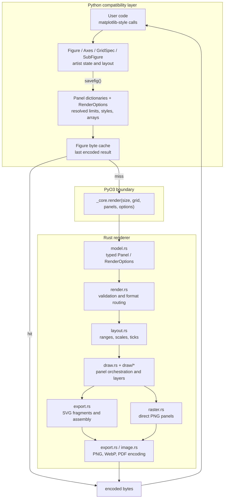
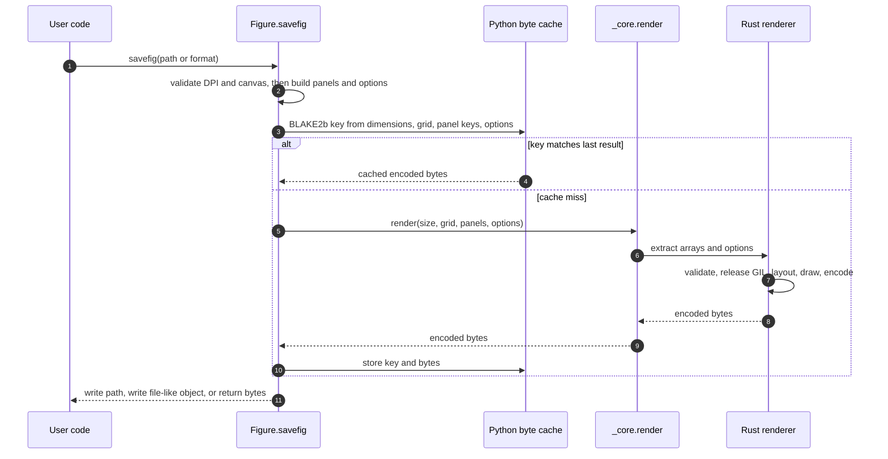
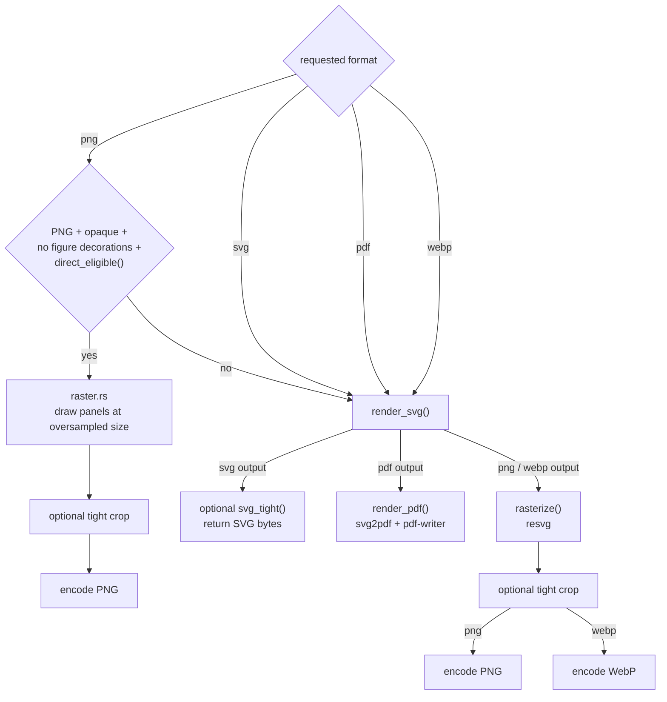

# Architecture

Matplotvite is a Python compatibility facade over a Rust renderer. Python code
builds the same kind of figure state that matplotlib would, but the state is
frozen into plain panel dictionaries at save time and handed to Rust through a
small PyO3 boundary. Rust performs layout, drawing, rasterisation, and encoding;
the Python layer never participates in the pixel pipeline.

The design keeps the public API easy to extend without rebuilding the renderer,
and keeps the native side independent of CPython objects once extraction is
complete.

## System map

The important boundary is `crates/matplotvite-core/src/render.rs::render_figure`:
Python owns path inference and input validation conventions;
`crates/matplotvite-py/src/py.rs` only wraps the renderer for PyO3 and maps its
`RenderError` to Python exceptions. Once the NumPy arrays have been copied into
`model::Panel`, the GIL is released and the native work is independent of
Python. The core crate has no Python dependency by default; the extension enables
its optional `python` feature for the extraction traits.

## Repository map

| Path | Responsibility |
|---|---|
| `python/matplotvite/__init__.py` | Public re-export facade: `__all__`, satellite imports and compatibility delegation for private internals. |
| `python/matplotvite/_plotting.py` | Re-export facade for the split implementation modules: binds the names a module only needs once called, mirrors facade patches to the owning module, and keeps `dir()` unchanged. |
| `python/matplotvite/_helpers.py`, `_containers.py`, `_artists.py`, `_axes_plot.py`, `_axes_stats.py`, `_axes_field.py`, `_axes_decor.py`, `_axes.py`, `_plot_helpers.py`, `_images.py`, `_figure.py`, `_pyplot.py`, `_config.py`, `_cm.py`, `_ticker.py`, `_png.py`, `_misc.py`, `_projections.py`, `_fonts.py` | Matplotlib-style implementation by concern: shared helpers and shim declarations, artist containers and artists, the `Axes` mixins and core class, `Figure`, the stateful pyplot facade, images/contours/colorbars, colormaps, locators/formatters, PNG I/O, projections and fonts. |
| `python/matplotvite/_pandas.py` | pandas plotting backend: translates `DataFrame.plot()`/`Series.plot(kind=...)` into the same `Axes` calls the public API uses. |
| `python/matplotvite/__init__.pyi` | PEP 561 type surface shipped with the wheel. |
| `crates/matplotvite-core/src/lib.rs` | Pure renderer crate: model, layout, drawing, rasterisation and export, with no Python dependency by default. |
| `crates/matplotvite-core/src/render.rs` | Canvas/format/compression validation, direct-PNG vs SVG routing, tight cropping, and output encoding. |
| `crates/matplotvite-core/src/model.rs` | `Panel`, `RenderOptions`, and the typed artist records extracted from Python. |
| `crates/matplotvite-core/src/layout.rs` | Data ranges, autoscaling, axis bounds, and tick generation. |
| `crates/matplotvite-core/src/draw.rs`, `.../draw/*` | Panel orchestration, plus the axes, bars, collection, colorbar, contour, image, legend, markers, polyline, quiver, series, text and tick drawing modules. |
| `crates/matplotvite-core/src/fonts.rs` | Registration of the embedded DejaVu Sans and Geist faces used by the drawing stack. |
| `crates/matplotvite-core/src/raster.rs` | Direct opaque-PNG path: panel rendering at an oversampled resolution and box filtering. |
| `crates/matplotvite-core/src/export.rs` | SVG assembly, the per-panel fragment cache, PDF conversion, rasterisation, PNG/WebP/EPS encoding. |
| `crates/matplotvite-core/src/image.rs` | Image scaling, background compositing, and image-to-PNG helpers. |
| `crates/matplotvite-core/src/color.rs`, `.../cmap_data.rs`, `.../cmaps.txt` | Colour normalisation and colormap tables. |
| `crates/matplotvite-core/src/scale.rs` | Axis scale transforms (`symlog`, `logit`, `asinh`) and the integer-oversampling drawing backend used by the bitmap path. |
| `crates/matplotvite/src/api.rs` | Native Rust `Figure`/`Axes` builder for the priority plotting methods, rendering through the shared panel pipeline. |
| `crates/matplotvite-py/src/lib.rs`, `.../py.rs` | Thin PyO3 extension: GIL release, error mapping, module exports, norms and colormaps. |
| `crates/matplotvite-core/src/bench.rs`, `.../benches/render.rs` | Criterion-facing output-stage benchmarks. |

## Save and render flow

`Figure.savefig()` is the normal entry point. It validates the requested DPI
and canvas size, converts each visible `Axes` into a panel dictionary, resolves
text/axes coordinates into the form the renderer understands, computes a
fingerprint, and either reuses the previous bytes or calls `_core.render()`.

A saved figure is immutable with respect to the cache: changing any artist,
style, label, DPI, size, or output option changes the cache key. The cache holds
the last encoded result per `Figure`, not a history of results.

## Output routing

The renderer has two output paths. The direct bitmap path is a PNG optimisation;
all other formats and cases go through an SVG document.

The direct path is selected only when the output is an opaque PNG, there are no
figure-level decorations, and `direct_eligible()` accepts the panels. Dense
marker layers, images that require smoothing, and small single-panel figures
stay on the SVG path, where resvg applies the full vector rendering.

## Drawing and layout

`layout.rs` turns data and explicit limits into finite axis ranges, applies the
matplotlib-style padding rule, and computes tick positions and labels. It also
handles logarithmic scales and the figure/axes panel rectangles.

Colorbar requests travel as panel metadata (`cmap`, `vmin`, `vmax`, `label`,
orientation, axis scale, display limits, `extend` geometry and `extendfrac`
length). The Python facade resolves both mappable-based `fig.colorbar(...)` calls
and standalone `Colorbar(ax, ...)` construction into that record; Rust maps the
gradient and ticks through the requested axis scale and limits, then draws any
extension triangles or rectangles at the requested length.

`draw.rs` orchestrates one panel into an SVG fragment using plotters' SVG backend and delegates each artist layer to `draw/*`.
Each fragment uses absolute canvas coordinates, so `export.rs` can concatenate
independent panel fragments in panel order rather than translating each panel
into a shared coordinate system. Text uses embedded DejaVu Sans by default,
with Geist serif and monospace faces; no system font lookup or graphics stack
is required.

Dense scatter, collection, and marker layers can be composited into bitmap
overlays inside the SVG path. That keeps the vector document small while
preserving the vector output for the rest of the figure.

## Artist ordering and legends

Python assigns each drawable artist a monotonically increasing creation sequence
number when it is added, and marks bar containers separately. `Axes._panel()`
sorts the labelled artists from those stamps and writes only the resulting labels
to `legend.order`; the sequence bookkeeping is removed before the panel reaches
Rust. Ordinary bar containers sort after other artists, while histogram bars are
marked as non-containers so they stay in creation order. The renderer therefore
sees a small, typed ordering contract instead of a parallel Python label list.

`Axes` is assembled from four concern mixins: plotting families, statistical
summaries, gridded/vector fields, and labels/annotation/legends. The core class
keeps lifecycle, layout, tick and scale state; panel serialization delegates
reference/polar data and tick resolution to helpers, while custom-scale mapping
is split across point, geometry, artist and limit helpers.

## Caching and concurrency

There are two caches:

| Cache | Scope | Key | Bound |
|---|---|---|---|
| `Figure._render_cache` | Python, per figure | BLAKE2b of dimensions, grid, panel keys, and output options | One encoded result |
| `PANEL_CACHE` | Rust, process-wide | SHA-1 panel fingerprint + canvas + grid + top padding + raster mode | 256 fragments or 64 MiB |

The panel fingerprints use SHA-1 because it is faster over large arrays; the
figure-level cache hashes those fingerprints and the output options with a
16-byte BLAKE2b digest. The Rust cache stores SVG panel fragments and is used by
the vector path. It is
safe to share across figures because the key includes every input that can
change a fragment. The Python cache avoids even entering Rust when the same
figure is saved twice unchanged.

After extraction, `lib.rs` releases the GIL with `py.detach`. Rayon then renders
independent panels in parallel in both `render_svg()` and `render_png()`;
image row scaling and some raster operations are parallelised as well.

The object-oriented `Figure`/`Axes` API is the thread-safe path: figures hold
their own state once created. The pyplot shims keep a process-wide figure
registry, guarded by a lock only for registration and current-figure selection.

## Data and compatibility boundaries

The Python layer deliberately implements a focused subset of matplotlib rather
than a full transform stack:

- `Figure`, `Axes`, `GridSpec`, `SubplotSpec`, and `_SubFigure` hold the
  user-facing state and produce panel dictionaries.
- `Axes._panel()` resolves axis/figure-fraction text, limits, ticks, bars,
  collections, and images into the typed records in `crates/matplotvite-core/src/model.rs`;
  its concern mixins and panel/scale helpers are described above.
- `RenderOptions` carries format, DPI, transparency, tight-cropping,
  compression, figure title, and figure-level text.
- Axis transforms cover linear, log, symlog, logit, asinh, function, and registered
  custom scales. Custom projections can override `_set_lim_and_transforms`;
  `polar=True` constructs `PolarAxes`, while the `Axes3D` and `SkewXAxes`
  projections are compatibility shims that accept their API and draw on the 2-D
  panel.
- `data=` dictionaries are resolved to their array values before numeric
  conversion in the main plotting and fill helpers. pandas DataFrames and
  Series also work through `pd.options.plotting.backend = "matplotvite"`;
  `_pandas.py` maps `kind=` and its defaults onto the same panel-producing
  methods, and pandas remains an optional dependency.
- The Rust side never imports Python modules or calls back into user code; after
  extraction it works only with copied numeric arrays and strings.

To add a feature, the usual path is:

1. Add the matplotlib-compatible method or property in the Python facade.
2. Add or extend a record in `crates/matplotvite-core/src/model.rs` and populate it from `_panel()`.
3. Draw it in `crates/matplotvite-core/src/draw.rs` or a module under `.../draw/` (and, if needed, route it through `.../export.rs`).
4. Add a Python regression test and, where relevant, a gallery example.

Canvas limits, bin limits, and grid-cell limits are enforced in Python for early
errors and again in Rust at the FFI boundary for defence in depth. The shipped
package does not shell out or use `eval`/`exec`; the gallery harvester is a
development tool and executes pinned third-party snippets in-process, as
documented in the README.

## Verification surfaces

- `pytest` covers the Python API, render options, output formats, the pandas
  backend and the rendering galleries; the current suite is **590 passed,
  5 skipped**.
- `tests/mpl_corpus.json` checks in 526 Matplotlib 3.11.2 snippets and baseline
  image hashes; `tools/harvest_matplotlib.py --check-metadata` fails CI when the
  metadata drifts.
- `tests/test_seaborn_parity.py` diffs six thin Seaborn wrapper scenes against
  committed Matplotlib references with RGBA RMS tolerances.
- `tests/test_pandas_backend.py` exercises pandas' backend dispatch, every
  supported `kind=`, index handling and the documented failure modes.
- `cargo test --workspace --all-targets` covers layout, raster, encoding and both native front ends.
- `cargo test -p matplotvite-core --no-default-features` proves the renderer builds and tests without Python.
- `tools/trace_unsupported.py --check` tracks calls from matplotlib's own test
  suite.
- The comparison galleries exercise pinned matplotlib and seaborn material;
  their rendered counts are an upper bound because pinned helper code can do
  part of the work. The current Matplotlib examples run renders 389 of 507
  scripts, with the remaining cases interactive, 3-D, environment-specific, or
  blank because they create no saved figure. The full `@image_comparison`
  corpus renders 495 of 526 cases (0 failed, 26 unsupported, 5 blank); backend
  and projection cases render, including PngSuite through the standard-library
  PNG reader.
- `prek` and CI run formatting, Clippy, Rust tests, Bandit, and the security
  audit. `prek checks` is a required status check for `main`.
- Wheel CI builds stable-ABI (`cp39-abi3`) wheels for manylinux and musllinux
  (x86_64, aarch64), macOS (arm64, x86_64), and Windows (x64, arm64).
